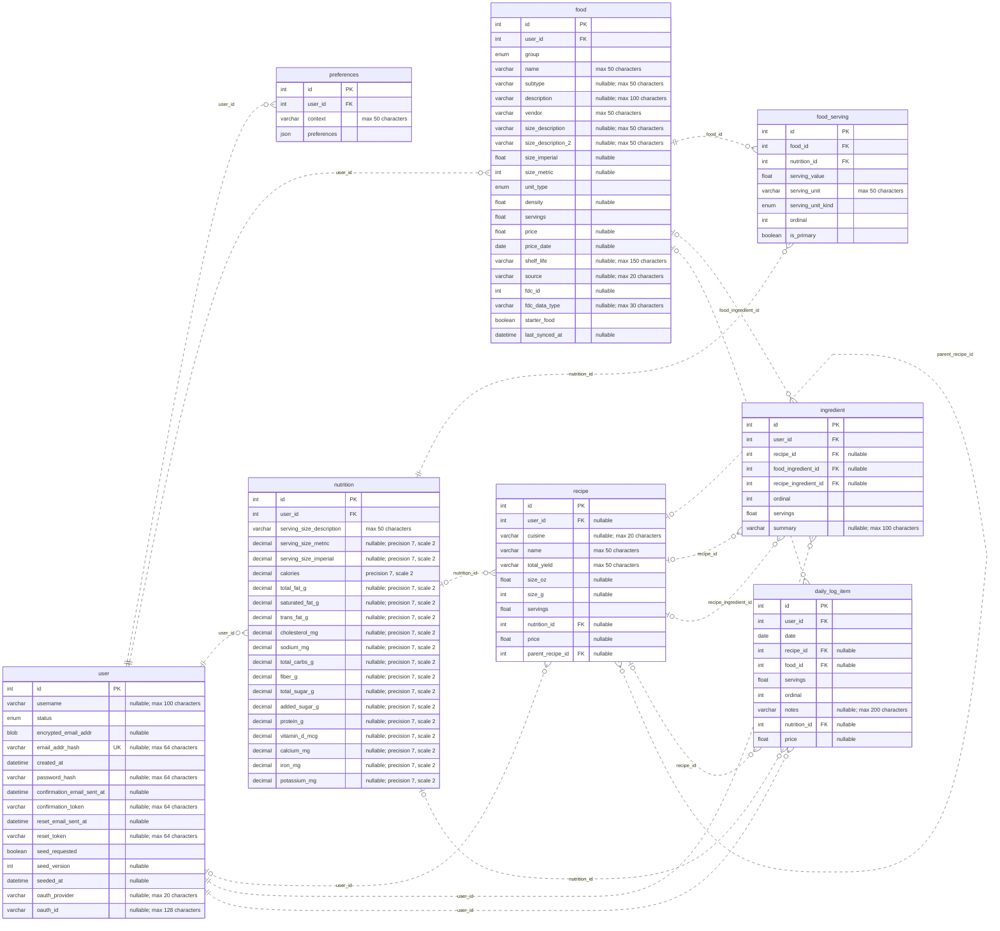

# TrackEats entity relationship diagram

This diagram describes the eight application tables in the current SQLAlchemy model, including the `food_serving` rename. It does not inspect a running database or include Alembic’s migration-version table.

Each table lists all persisted columns. `PK` means primary key, `FK` means foreign key, and `UK` means a single-column unique constraint. Columns marked `nullable` can contain SQL `NULL`; other columns cannot. Database nullability does not determine whether an API field may be omitted: defaults and request validation also apply.

Relationship labels identify the foreign-key column on the child table. Each parent can have zero or many children. A circle at the parent end means the child’s foreign key is nullable; a double bar means it is required. Dotted lines indicate that the foreign key is not part of the child’s primary key.

## How the tables fit together

- **Ownership:** `user` owns food, nutrition, preferences, ingredients, and daily log entries. Recipe ownership is nullable in the database.
- **Food servings:** `food` contains identity, classification, package measurements, and price. Each `food_serving` belongs to one food and links to one nutrition record. The primary serving supplies the food’s default nutrition; other rows describe additional serving options. The application expects exactly one primary serving per food; the current database model does not enforce that rule with a unique constraint.
- **Import identity:** each `(user_id, source, fdc_id)` combination is unique when source and USDA ID are present. This prevents duplicate imports for an owner while allowing separate users to hold copies and manual foods to omit import identity.
- **Nutrition:** `nutrition` holds serving measurements, calories, and nutrients. Its foreign keys from servings, recipes, and daily log entries are not unique, so the database permits multiple records to reference the same nutrition row. Separate nutrition rows for food servings are an application convention.
- **Recipes:** `recipe.nutrition_id` links directly to stored nutrition totals for the whole recipe, calculated from its ingredients. `parent_recipe_id` optionally links a variation to its original recipe.
- **Ingredients:** `ingredient.recipe_id` identifies the containing recipe. An ingredient refers to either a food through `food_ingredient_id` or a nested recipe through `recipe_ingredient_id`, with `servings` recording the quantity. The application requires a containing recipe and exactly one ingredient target; the database columns are nullable and have no exclusive-or constraint. Food ingredients use the food’s primary serving rather than referencing a `food_serving` directly.
- **Daily log:** `daily_log_item` records a date, quantity, ordering, notes, and price. It can reference a food or recipe, and its direct nutrition link stores a snapshot of the selected serving’s nutrition. It has no foreign key to `food_serving`.
- **Preferences:** each `(user_id, context)` pair is unique, allowing one JSON preferences record per user and context.

## Naming and scope

`food_serving` was previously named `nutrition_alternative`. Databases must apply the rename migration to match this diagram. The existing API field and ORM collection are still called `nutrition_alternatives` for compatibility.

Food groups, unit kinds, and user statuses are enum columns rather than separate tables. This diagram shows foreign-key structure, not cascade/deletion behavior or every application validation rule.
